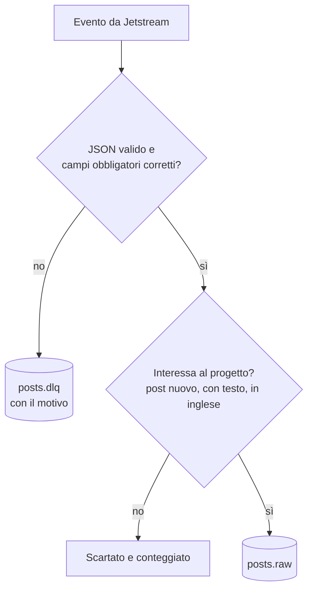
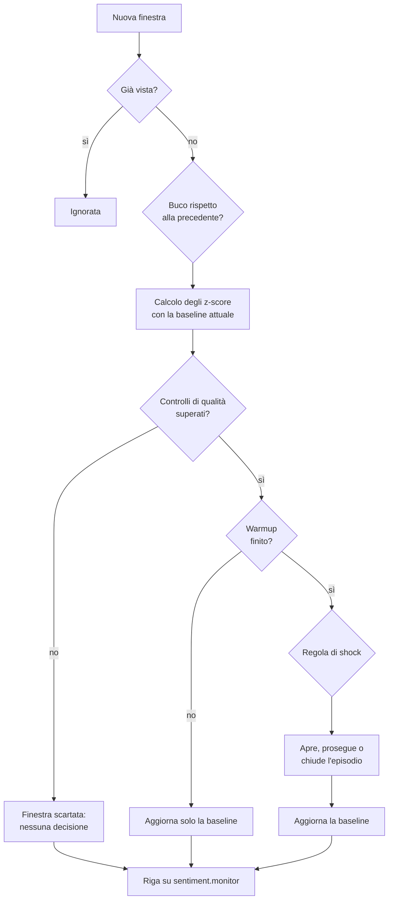
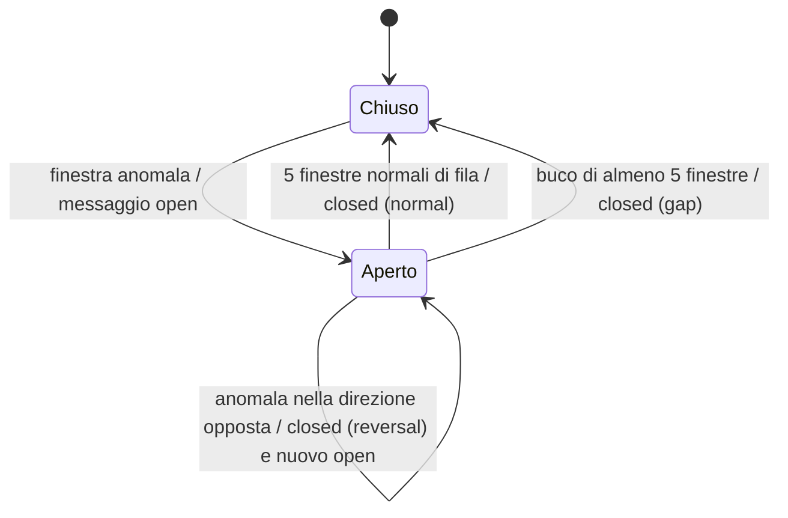
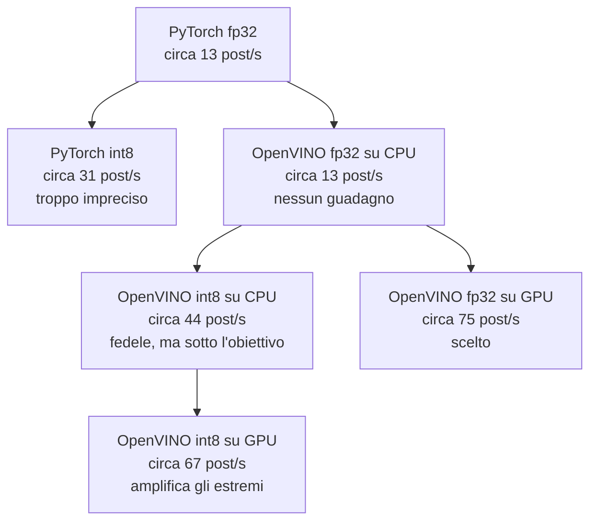

# Relazione Progetto TAP

Progetto creato da **Francesco Greco** per il corso "_Technologies for Advanced Programming_" 25/26, triennale in Informatica all'Università di Catania.

**Indice**:

- [1. Introduzione](#1-introduzione)
- [2. I dati: Bluesky e Jetstream](#2-i-dati-bluesky-e-jetstream)
- [3. Architettura della pipeline](#3-architettura-della-pipeline)
- [4. Calcolo del sentiment (Q1)](#4-calcolo-del-sentiment-q1)
- [5. Aggregazione per minuto (Q2)](#5-aggregazione-per-minuto-q2)
- [6. Rilevamento degli shock (Q3)](#6-rilevamento-degli-shock-q3)
- [7. Spiegazione automatica degli shock (explainer)](#7-spiegazione-automatica-degli-shock-explainer)
- [8. Ottimizzazione delle prestazioni](#8-ottimizzazione-delle-prestazioni)
- [9. Analisi di una sessione di ascolto](#9-analisi-di-una-sessione-di-ascolto)
- [10. Visualizzazione con Kibana](#10-visualizzazione-con-kibana)
- [11. Limiti e sviluppi futuri](#11-limiti-e-sviluppi-futuri)
- [12. Conclusioni](#12-conclusioni)

**Appendici** (file separati):

- [A. Topic Kafka e formato dei messaggi](Appendice_A_Topic_e_messaggi.md)
- [B. Dettagli dell'explainer](Appendice_B_Explainer.md)
- [C. Benchmark completi di Q1](Appendice_C_Benchmark.md)
- [D. Le dashboard di Kibana](Appendice_D_Kibana.md)
- [E. Privacy e GDPR](Appendice_E_Privacy.md)

---

# 1. Introduzione

Ogni minuto su Bluesky vengono pubblicati migliaia di post. Presi uno per uno dicono poco, ma messi insieme raccontano l'umore di una comunità molto grande. Quando succede qualcosa di importante, come un terremoto, il risultato di un'elezione o il guasto di un servizio usato da milioni di persone, il tono di quello che la gente scrive cambia nel giro di pochi minuti.

Ho realizzato una pipeline che legge in tempo reale i post in inglese pubblicati su Bluesky, assegna a ciascuno un punteggio di sentiment con un modello di linguaggio e controlla, minuto per minuto, se il sentiment medio si sta comportando in modo anomalo. Quando trova un cambiamento improvviso segnala uno "shock" e, una volta concluso l'episodio, prova a spiegarne la causa raccogliendo i post di quel momento e chiedendo un riassunto a un LLM.

Ho scelto Bluesky perché, a differenza di altri social network, rende disponibile gratuitamente il flusso completo dei post pubblici attraverso un servizio chiamato Jetstream. Questo permette di lavorare su dati reali, in tempo reale e senza costi di accesso.

## 1.1 Obiettivo

L'obiettivo è rispondere in modo automatico a due domande: **quando** il sentiment su Bluesky cambia in modo anomalo, e **perché**.

La risposta deve arrivare in fretta, nell'ordine di pochi minuti, e deve essere affidabile: un sistema che segnala troppi falsi allarmi smette presto di essere ascoltato. Per questo la pipeline controlla anche la qualità dei dati, scartando per esempio i minuti in cui pochi account pubblicano moltissimi post, tipico segnale di spam, e quelli in cui la raccolta dei dati si è interrotta.

C'era infine un vincolo pratico: tutto il sistema doveva girare su un normale computer portatile. Questo ha reso necessario un lavoro di ottimizzazione sulla parte che esegue il modello di linguaggio, descritto nel capitolo 8.

## 1.2 Cosa si intende per shock

A ogni post la pipeline assegna un punteggio di sentiment tra -1 (molto negativo) e +1 (molto positivo), e per ogni minuto calcola la media dei punteggi. Questa media oscilla un po' da un minuto all'altro e cambia lentamente nel corso della giornata. Il sistema tiene quindi traccia di un valore "tipico", chiamato **baseline**, che rappresenta il comportamento recente e si aggiorna man mano che arrivano nuovi dati.

Uno **shock** è un minuto in cui il sentiment medio si allontana dalla baseline molto più di quanto faccia normalmente. Conta quindi quanto il valore è insolito rispetto all'ultima ora circa, non il suo valore assoluto. Se il sentiment si aggira intorno a +0,05 e di solito oscilla di un centesimo, un minuto a -0,07 è uno shock; un calo lento nel corso di qualche ora no, perché la baseline lo segue.

Uno shock può essere un cambiamento del sentiment molto forte, oppure un cambiamento più moderato accompagnato da un'esplosione del numero di post. Un aumento dei post senza un cambiamento del sentiment, invece, non è uno shock: può essere una partita, un meme o un argomento di tendenza che non sposta l'umore generale. I minuti anomali vicini nel tempo vengono raggruppati in un unico **episodio**, con un inizio, una fine, una direzione e un'intensità misurata nel momento di picco.

## 1.3 A chi può servire

Un sistema di questo tipo è utile a chi deve accorgersi in fretta di quello che succede, senza tenere qualcuno a guardare i social tutto il giorno. Le **redazioni giornalistiche** potrebbero usarlo già così com'è, per ricevere in pochi minuti un segnale e una prima spiegazione da verificare. Per le **aziende**, il caso più interessante dal punto di vista commerciale, un disservizio o una polemica si riflettono subito nel tono dei post, e accorgersene presto permette di reagire prima che il problema si allarghi. Possibili utilizzatori sono anche gli enti di **gestione delle emergenze** e gli operatori del settore **finanziario**.

Nella versione attuale il sistema osserva l'intero flusso dei post in inglese, quindi intercetta soprattutto eventi di grande portata. Per adattarlo a un'azienda servirebbe un filtro a monte su parole chiave o hashtag, con finestre più lunghe e soglie ricalibrate (capitolo 11). Il sistema usa solo componenti open source, dati gratuiti e il piano gratuito di un LLM, e gira su un portatile: anche una piccola realtà potrebbe provarlo senza investimenti iniziali.

---

# 2. I dati: Bluesky e Jetstream

Bluesky è un social network simile a X: gli utenti pubblicano post brevi, fino a 300 caratteri, rispondono ad altri post, li citano e condividono link. È costruito su un protocollo aperto, l'**AT Protocol**, per cui i post pubblici sono accessibili a chiunque, in tempo reale e gratuitamente. Ogni utente è identificato da un **DID** permanente (per esempio `did:plc:ewvi7nxzyoun6zhxrhs64oiz`), e ogni post da un **AT-URI** univoco nella forma `at://<did>/app.bsky.feed.post/<chiave>`, che nella pipeline è la chiave per riconoscere i duplicati.

Tutti gli eventi della rete passano da un flusso unico, il firehose. Bluesky mette a disposizione **Jetstream**, un servizio che trasmette gli stessi eventi in JSON su una connessione WebSocket. Il progetto usa questo indirizzo:

`wss://jetstream.us-east.bsky.network/xrpc/network.bsky.jetstream.subscribeEvents?kinds=commit&collections=app.bsky.feed.post`

I filtri chiedono solo le operazioni sui post: like, repost e follow non vengono nemmeno trasmessi. Il server però non sa filtrare per lingua, quindi la selezione dei post in inglese la fa la pipeline. Dopo il filtro, nelle ore di punta della sera americana arrivano circa 33 post in inglese al secondo, cioè circa 2000 al minuto.

## 2.1 I campi conservati

Un messaggio di Jetstream contiene molte più informazioni di quelle che servono. La pipeline segue un approccio a **lista bianca**: estrae solo i campi utili e scarta il resto, appiattendo il messaggio in una struttura semplice:

```json
{
  "uri": "at://did:plc:ewvi7nxzyoun6zhxrhs64oiz/app.bsky.feed.post/3myfgj6zbwh2o",
  "did": "did:plc:ewvi7nxzyoun6zhxrhs64oiz",
  "time": "2026-10-21T15:08:23.966505Z",
  "text": "Just saw the news about the earthquake, hope everyone is safe",
  "langs": ["en"],
  "link_title": "Strong earthquake hits..."
}
```

`uri` identifica il post, `did` l'autore (serve a contare gli autori distinti e a riconoscere lo spam), `time` decide in quale minuto cade il post e `text` è l'input del modello. Come orario si usa `time`, scritto da Jetstream, e non `createdAt`, che viene deciso dall'app dell'utente e può essere sbagliato. Tre campi facoltativi, `link_title`, `reply_parent_uri` e `quoted_uri`, non servono a calcolare il sentiment ma a spiegarlo: dicono quali notizie venivano condivise e quali post erano al centro della discussione. Il titolo del link non viene passato al modello, perché di solito è scritto da una testata e non dall'autore del post. Il formato completo dei messaggi è nell'[Appendice A](Appendice_A_Topic_e_messaggi.md).

## 2.2 Affidabilità e privacy

Jetstream consegna i record così come li scrivono le app, senza controllarli: capitano campi mancanti o inventati. La lista bianca rende la pipeline robusta, perché i campi sconosciuti vengono ignorati e un messaggio senza i campi indispensabili viene messo da parte per poterlo esaminare. Jetstream garantisce inoltre che ogni evento arrivi almeno una volta, non esattamente una volta, per cui la pipeline elimina i duplicati usando l'`uri`.

Anche se pubblici, i post sono dati personali tutelati dal **GDPR**. La pipeline applica la minimizzazione dei dati e la limitazione della conservazione: tiene solo i campi necessari, scarta subito i post nelle altre lingue e cancella i singoli post dopo tre giorni. Restano senza scadenza solo le statistiche al minuto e gli alert. Queste scelte non bastano da sole a rendere il sistema conforme; le questioni aperte sono discusse nell'[Appendice E](Appendice_E_Privacy.md).

---

# 3. Architettura della pipeline

## 3.1 Schema generale

La pipeline è una catena di fasi collegate da Kafka: nessun componente parla direttamente con un altro, ma ognuno legge da un topic e scrive su un altro.


Il producer riceve i post da Bluesky e li passa a Logstash, che li controlla, li pulisce e li scrive su Kafka. Spark calcola il sentiment di ogni post (Q1), lo raggruppa con gli altri post dello stesso minuto (Q2) e confronta ogni minuto con il comportamento recente per trovare gli shock (Q3). Quando uno shock si conclude, l'explainer recupera i post di quel periodo e chiede a un LLM di spiegare cosa è successo. Tutto finisce in Elasticsearch e si visualizza con Kibana.

"In tempo reale" va inteso in senso pratico: un post viene elaborato pochi secondi dopo la pubblicazione e uno shock viene segnalato nel giro di qualche minuto.

## 3.2 I componenti e il perché delle scelte

**Producer.** Un piccolo programma Python che apre la connessione WebSocket verso Jetstream e inoltra ogni evento a Logstash, così com'è, su TCP. Serve perché Logstash non ha un input WebSocket di serie. Non fa nessun controllo, così resta semplice e difficilmente si rompe. Accanto c'è un **producer sintetico**, usato durante lo sviluppo, che genera post finti con shock, picchi di volume e account di spam decisi a priori: serve a verificare il detector in situazioni controllate.

**Logstash.** Ha due compiti, svolti da pipeline separate dentro lo stesso processo. La pipeline `ingest` riceve gli eventi, scarta quelli che non interessano, controlla i campi obbligatori e scrive i post validi su `posts.raw` (sezione 3.3); una pipeline gemella, `ingest-synthetic`, traduce i post del producer sintetico nello stesso formato. Altre tre pipeline leggono i topic finali e li scrivono in Elasticsearch, ognuna con una coda su disco: se Elasticsearch rallenta, il resto della pipeline continua a lavorare. Ho scelto Logstash invece di un programma Python o di Kafka Connect perché descrive filtri e controlli in configurazione, offre già pronti input TCP, output Kafka ed Elasticsearch e code su disco, e fa parte della stessa suite di Elasticsearch e Kibana. Il limite è che, senza codice aggiuntivo, controlla la forma dei campi ma non il loro tipo: il controllo viene ripetuto in Spark.

**Kafka.** Il collegamento tra tutte le fasi. Rende le fasi indipendenti (se Q1 si ferma, i post si accumulano e vengono elaborati alla ripartenza), assorbe i picchi e permette di rielaborare i dati, per esempio di far girare il detector con parametri diversi senza ricalcolare il sentiment. Gira con un solo nodo in modalità KRaft. L'alternativa RabbitMQ cancella un messaggio appena viene letto, mentre Redis Streams tiene i dati in memoria, scarsa su un portatile.

**Spark.** Il progetto usa **Structured Streaming** con tre query: Q1 calcola il sentiment, Q2 aggrega per minuto, Q3 è il detector. Q1 è la fase più pesante e gira in un'applicazione separata, con priorità più alta sulla CPU e accesso alla GPU integrata; Q2 e Q3 sono leggere e condividono un'applicazione per risparmiare memoria, pur restando query indipendenti. Ogni query salva i progressi in un **checkpoint** e dopo un riavvio riprende dall'ultimo micro-batch completato.

Structured Streaming lavora a **micro-batch**: ogni dieci secondi legge da Kafka i messaggi arrivati e li elabora come un piccolo blocco. Non è streaming in senso stretto, ma qui non è un limite: la latenza aggiunta è di pochi secondi su un ritardo che è comunque di minuti, dato che il detector ragiona su finestre di un minuto. Per Q1 è anzi un vantaggio, perché un modello di linguaggio è molto più efficiente su gruppi di testi. L'alternativa naturale era Flink, con latenze più basse che qui non servono; Spark ha invece un'interfaccia Python matura, necessaria per eseguire il modello, e offre già pronti finestre temporali, watermark, deduplica e stato persistente.

**Elasticsearch e Kibana.** Elasticsearch conserva tre indici: i singoli post (per tre giorni), una riga per minuto con le statistiche e lo stato del detector, e un documento per episodio con la sua spiegazione. Non è solo una destinazione: la sua capacità di cercare nel testo e di trovare le parole insolitamente frequenti in un intervallo è ciò che serve all'explainer. InfluxDB gestirebbe bene le serie temporali ma non i testi, PostgreSQL non offre analisi pronte come i termini significativi. Kibana, rispetto a Grafana, permette anche di esplorare e filtrare i singoli post dalla stessa interfaccia del grafico.

**Explainer.** Un servizio Python esterno a Spark che, alla chiusura di ogni episodio, raccoglie evidenze da Elasticsearch e chiede una spiegazione a Gemini (capitolo 7). Lavora su pochi eventi al giorno e passa quasi tutto il tempo ad aspettare: dentro Spark avrebbe solo legato i tempi del detector a quelli di un servizio esterno.

**Docker Compose.** Tutti i componenti girano in container descritti in un unico `docker-compose.yml`, con le impostazioni che cambiano più spesso in un file `.env`. Servizi di inizializzazione preparano l'ambiente prima che parta il resto: `kafka-init` crea i topic, `es-init` gli indici e `kibana-init` importa le dashboard. A ogni container è assegnato un peso sulla CPU, in modo che Q1 abbia la precedenza, e tutte le porte sono esposte solo in locale. Kubernetes avrebbe senso con più macchine, non su un solo portatile.

## 3.3 Ingestione

Ogni evento ricevuto da Logstash finisce in uno e un solo posto, scelto tra tre:



Un evento **scartato per scelta** è corretto ma non interessa: cancellazioni e modifiche (interessa il momento in cui le persone scrivono), post senza testo e post che non dichiarano la lingua `en`. Viene solo conteggiato. Un **dato rotto**, per esempio senza autore o con un orario inesistente, viene invece messo da parte nel topic `posts.dlq`, una **dead letter queue**, insieme al motivo dello scarto, perché indica che qualcosa non va nella sorgente o nella pipeline. Ogni controllo ha un nome e Logstash conta quanti eventi passano da ciascuno, quindi dall'API di monitoraggio si sa in ogni momento quanti post sono stati scartati e perché. L'elenco completo dei controlli è nell'[Appendice A](Appendice_A_Topic_e_messaggi.md).

Il filtro sulla lingua viene fatto solo qui, così i post nelle altre lingue non entrano mai in Kafka. È volutamente semplice: un post che dichiara `en-GB` invece di `en` viene escluso, una perdita di circa lo 0,4% dei post in inglese in cambio di una regola chiara. I campi facoltativi sono trattati con più tolleranza: se l'indirizzo del post citato è malformato, il post perde solo quel campo.

## 3.4 I topic Kafka

La creazione automatica dei topic è disattivata, così un errore di battitura nel nome di un topic produce un errore invece di creare in silenzio un topic che nessuno legge. I topic li crea `kafka-init`:

| Topic | Scritto da | Letto da | Partizioni | Conservazione | Chiave |
|---|---|---|---|---|---|
| `posts.raw` | Logstash | Q1 | 3 | 3 giorni | `uri` |
| `posts.dlq` | Logstash | nessuno | 1 | 3 giorni | nessuna |
| `posts.enriched` | Q1 | Q2, Logstash | 3 | 3 giorni | `uri` |
| `sentiment.1m` | Q2 | Q3 | 1 | illimitata | `window_start` |
| `sentiment.monitor` | Q3 | Logstash | 1 | illimitata | `window_start` |
| `alerts` | Q3 | Logstash, explainer | 1 | illimitata | `alert_id` |
| `alerts.explained` | explainer | Logstash | 1 | illimitata | `alert_id` |

I **topic dei post** hanno tre partizioni per poter essere letti in parallelo; l'ordine non conta, perché Q2 colloca ogni post nel minuto giusto in base al suo orario. La chiave `uri` manda tutte le copie dello stesso post nella stessa partizione. I **topic a valle** hanno una sola partizione, perché Kafka garantisce l'ordine solo dentro una partizione e qui l'ordine è essenziale: il detector deve vedere i minuti in ordine, ed Elasticsearch deve ricevere l'apertura di un episodio prima della sua chiusura.

I topic con i post sono voluminosi e contengono testi personali, quindi tengono tre giorni di dati. Gli altri contengono una riga al minuto o pochi messaggi al giorno, occupano pochissimo e restano senza scadenza, proprio per permettere la rielaborazione.

## 3.5 Principi di progettazione

Alcuni principi attraversano tutta la pipeline. Le **fasi sono disaccoppiate**: comunicano solo attraverso Kafka, quindi un guasto in un punto non blocca il resto. C'è **tolleranza ai guasti**: grazie ai checkpoint e ai dati conservati in Kafka, ogni fase riprende da dove si era fermata. I **duplicati sono innocui**: invece di impedirli, la pipeline li elimina e salva ogni dato in Elasticsearch con un identificativo fisso, così una seconda scrittura sovrascrive la prima. I **risultati sono riproducibili**: le decisioni si basano sull'orario dei post e non sull'orologio del computer, quindi rielaborando gli stessi dati si ottengono sempre gli stessi risultati.

---

# 4. Calcolo del sentiment (Q1)

Q1 legge i post da `posts.raw`, elimina i duplicati, assegna a ciascuno un punteggio di sentiment e scrive il risultato su `posts.enriched`. È la fase più pesante della pipeline, perché esegue una rete neurale su ogni post.

## 4.1 Il percorso di un post

A ogni micro-batch Q1 legge al massimo 1500 post. In condizioni normali ne arrivano molti meno in dieci secondi; il limite serve quando c'è un arretrato da recuperare, che viene così smaltito a blocchi. I messaggi vengono letti con uno **schema esplicito**: un campo del tipo sbagliato diventa nullo invece di bloccare l'elaborazione, completando i controlli di Logstash. Vengono scartati i messaggi senza `uri`, senza autore o con un orario illeggibile.

I duplicati vengono eliminati sull'`uri` **prima** di eseguire il modello, per non sprecare calcolo nella fase più lenta. Per non ricordare gli `uri` per sempre, Q1 usa un **watermark** di dieci minuti di event time: dimentica gli `uri` più vecchi. Q1 garantisce che ogni post arrivi a valle almeno una volta, non esattamente una volta, per cui anche Q2 elimina di nuovo i duplicati.

## 4.2 Il modello

Il modello è **`cardiffnlp/twitter-roberta-base-sentiment-latest`**, un RoBERTa con circa 125 milioni di parametri. È stato pre-addestrato su circa 124 milioni di tweet scritti tra il 2018 e il 2021, imparando il linguaggio dei social, e poi specializzato su tweet classificati a mano come negativi, neutri o positivi. A differenza di un metodo a dizionario tiene conto del contesto: "sick" è negativo in "I feel sick" e positivo in "this beat is sick".

Le alternative erano i metodi a dizionario come VADER, velocissimi ma imprecisi su contesto, ironia e negazioni; modelli più grandi o multilingua, troppo lenti per un portatile (capitolo 8); un LLM generico, insostenibile con migliaia di post al minuto. Il modello scelto è addestrato proprio su testi brevi dei social, gira su un portatile ed è tra i più diffusi e documentati.

## 4.3 Dal testo al punteggio

Prima del modello, le menzioni diventano `@user` e i link `http`, come durante l'addestramento. I post sono brevi, in media circa 28 token, e il limite di 256 token ne taglia solo lo 0,1%. Il modello restituisce tre probabilità che sommano a 1, da cui Q1 ricava l'**etichetta** (`sentiment_label`), cioè la classe più probabile, e il **punteggio** $s = p_{pos} - p_{neg}$, tra -1 e +1:

| Post (esempi illustrativi) | $p_{neg}$ | $p_{neu}$ | $p_{pos}$ | $s$ |
|---|---|---|---|---|
| "This is the best day of my life!!" | 0,01 | 0,03 | 0,96 | +0,95 |
| "The meeting is at 3pm" | 0,05 | 0,90 | 0,05 | 0,00 |
| "Not sure how I feel about the new update" | 0,30 | 0,55 | 0,15 | -0,15 |
| "I can't believe they did this. Disgusting." | 0,94 | 0,05 | 0,01 | -0,93 |

Il punteggio continuo è la grandezza su cui lavora tutto il resto. Con la sola etichetta un post appena negativo e uno furioso avrebbero lo stesso peso; con il punteggio la media riflette anche l'intensità dei toni ed è molto più sensibile ai cambiamenti. L'etichetta resta utile per calcolare le quote di post negativi e positivi.

## 4.4 Il modello dentro Spark

Spark gira sulla JVM, il modello in Python. Q1 li collega con una **pandas UDF**, che riceve i post a blocchi in formato Apache Arrow. Dentro ogni blocco i post vengono passati al modello in gruppi di 32, ordinati per lunghezza per ridurre al minimo i token di riempimento. Il modello viene caricato una sola volta per processo, e la funzione è marcata in modo che l'ottimizzatore di Spark non la esegua due volte, una per il punteggio e una per l'etichetta. Il motore di inferenza si sceglie dal `.env`; se il valore è sbagliato o manca il modello convertito, Q1 si ferma subito con un errore chiaro.

Ogni post riceve un campo `model`, per esempio `cardiffnlp/twitter-roberta-base-sentiment-latest+ov:fp32@GPU`, che indica modello e motore. Motori diversi danno valori leggermente diversi: grazie a questo campo, Q2 non li mescola nella stessa finestra e Q3 costruisce per ciascuno una baseline separata.

## 4.5 Limiti del modello

Il modello non sempre riconosce ironia e sarcasmo, ha imparato la lingua da tweet fino al 2021, è stato addestrato su Twitter e non su Bluesky, e non vede immagini né il contenuto dei link. Per il progetto questi limiti pesano meno di quanto sembri, perché il detector non giudica i singoli post ma la **media** di migliaia di post, confrontata con la media dei minuti precedenti calcolata con lo stesso modello. Gli errori sui singoli post tendono a compensarsi, e un errore sistematico è presente sia nel minuto osservato sia nella baseline, quindi non crea falsi shock.

---

# 5. Aggregazione per minuto (Q2)

Q2 trasforma il flusso dei singoli post in una serie temporale. Legge da `posts.enriched` solo i campi che servono (`uri`, `did`, `time`, `sentiment`, `sentiment_label`, `model`), raggruppa i post per minuto e scrive su `sentiment.1m` una riga al minuto. È la serie che il detector osserva.

## 5.1 Finestre di un minuto

Le finestre sono di tipo **tumbling**: durata fissa, una dopo l'altra, senza sovrapposizioni. Il minuto di un post si decide con il campo `time` e non con il momento in cui Q2 lo elabora (**event time**): se Q2 recupera alle 11:00 i post delle 10:15, li mette comunque nella finestra delle 10:15. La serie descrive quindi cosa è successo su Bluesky, non quando la pipeline ha fatto i calcoli.

Un minuto è un compromesso. Con circa 1800 post al minuto la media è già stabile, e finestre corte permettono di accorgersi prima di un cambiamento; finestre di cinque minuti avrebbero ritardato ogni segnalazione. Ho scartato le finestre scorrevoli perché due finestre vicine condividerebbero gran parte dei post, complicando la statistica del detector, che assume finestre indipendenti. La durata si cambia dal `.env`.

Per ogni finestra Q2 calcola:

| Campo | Cosa contiene |
|---|---|
| `window_start`, `window_end` | inizio e fine della finestra, in UTC |
| `n_posts` | numero di post |
| `n_authors` | numero di autori distinti (stima) |
| `mean_sentiment` | media del punteggio $s$: la grandezza osservata dal detector |
| `std_sentiment` | deviazione standard del punteggio |
| `share_negative`, `share_positive` | quote di post negativi e positivi |
| `model` | modello con cui è stato calcolato il sentiment |

`n_authors` è una **stima** calcolata con HyperLogLog, con un errore intorno al 2%: Spark non permette un conteggio esatto di valori distinti in streaming, e per riconoscere lo spam non serve. Le quote aiutano a leggere la media: nella sessione analizzata i post negativi (29,7%) erano più dei positivi (28,1%), eppure la media era leggermente positiva, perché i post positivi erano in media più decisi.

Un minuto senza post non produce alcun messaggio. Su Bluesky un minuto vuoto significa sempre che l'ingestione si è interrotta, e il detector riconosce questi buchi (capitolo 6). Le finestre sono raggruppate anche per `model`: se si cambia motore di Q1, nello stesso minuto possono convivere post calcolati in modi diversi, e mescolarli produrrebbe un salto artificiale nella serie.

## 5.2 Il watermark: quando una finestra è completa

Per pubblicare una finestra bisogna sapere che non arriveranno più post con un orario al suo interno. I post arrivano a Q2 con qualche secondo di ritardo e non sempre in ordine: Q1 non scrive i post di un micro-batch in ordine di tempo, e Q2 può leggere un micro-batch di Q1 solo in parte. Spark risolve il problema con il **watermark**, una soglia che segue il post più recente visto con un ritardo fisso, qui di due minuti:

$$W = t_{max} - 2\ \text{min}$$

Una finestra viene chiusa quando il watermark supera la sua fine; un post che arriva dopo, con un orario dentro una finestra già chiusa, viene scartato. La finestra 10:15–10:16, per esempio, viene chiusa quando arriva un post delle 10:18, cioè circa tre minuti dopo il suo inizio.

Il watermark non deve coprire la latenza della pipeline, ma il **disordine**: di quanto un post può arrivare dopo uno più recente. Una pipeline lenta ma ordinata non perde nulla. Il disordine massimo corrisponde circa all'intervallo coperto da un micro-batch di Q1: dieci secondi in regime normale, circa 50 secondi durante il recupero di un arretrato (1500 post a 30 post al secondo). Due minuti lasciano un buon margine, e la sessione del capitolo 9 lo conferma: confrontando i post contati nell'indice con `n_posts` di Q2, i valori coincidono in 349 minuti su 350. I post scartati in ritardo vengono registrati nei log di Q2.

Ogni finestra viene pubblicata **una sola volta, già completa**. Se il detector ricevesse una finestra ancora in corso, con 300 post invece di 1800, vedrebbe un crollo del volume che non esiste, e un messaggio già scritto su Kafka non si può correggere. Il prezzo sono circa tre minuti di attesa, poco rispetto al costo di un falso allarme. Il watermark avanza solo quando arrivano post: se l'ingestione si ferma, l'ultima finestra resta aperta, così non viene mai chiusa a metà.

## 5.3 Robustezza

Q2 elimina di nuovo i duplicati sull'`uri`, perché se Q1 si riavvia a metà di un micro-batch riscrive anche i post già scritti. Basta lo stesso watermark di due minuti: le copie hanno lo stesso orario degli originali. Una copia che arriva così tardi che Q2 ha già dimenticato l'originale trova la sua finestra già chiusa e viene scartata come dato in ritardo, quindi un post non viene mai contato due volte.

Q2 scarta anche i post con un orario più di dieci minuti nel futuro. Sembra superfluo, ma un solo post con data 2030 farebbe saltare il watermark al 2030, e da quel momento ogni nuovo post verrebbe scartato come in ritardo senza alcun errore visibile. È l'unico punto in cui Q2 usa l'orologio, e non compromette la riproducibilità: rielaborando dati passati nessun post è nel futuro.

Quando nello stesso micro-batch si chiudono molte finestre, come durante un recupero, Spark le scriverebbe in parallelo e in ordine casuale. Q2 le raccoglie quindi in un solo processo, le ordina per `window_start` e poi le scrive. Anche questa scrittura è "almeno una volta": dopo un riavvio Q2 può riscrivere finestre già pubblicate, ma il detector le ignora (capitolo 6). Una scrittura "esattamente una volta" richiederebbe le transazioni di Kafka, che il connettore di Spark non supporta.

Q2 e Q3 girano nello stesso container, `spark_q23`, come due query indipendenti con i propri topic e checkpoint. Una seconda applicazione avrebbe sprecato circa 0,8 GB di memoria per un'altra JVM. Ho preferito non unirle in un'unica query, perché il topic intermedio permette di rileggere la serie e provare il detector con parametri diversi. Lo svantaggio è che se una delle due si ferma con un errore si riavvia l'intera applicazione, ma grazie ai checkpoint entrambe riprendono senza perdere lavoro.

---

# 6. Rilevamento degli shock (Q3)

Q3 è il detector, il cuore del progetto. Per ogni minuto della serie risponde a una domanda: questo minuto è normale rispetto al comportamento recente, oppure il sentiment è cambiato all'improvviso? I minuti anomali vengono raggruppati in **episodi**, segnalati sul topic `alerts`. Per ogni minuto Q3 scrive anche una riga su `sentiment.monitor` con i calcoli fatti, così in Kibana si vede come ha ragionato. Q3 dice **quando** il sentiment è cambiato; il **perché** lo cerca l'explainer.

## 6.1 L'idea

Il sentiment medio non ha un valore "giusto" fisso: cambia con l'ora, con il pubblico collegato e con le notizie del giorno, quindi una soglia fissa darebbe allarmi continui in certi periodi e nessuno in altri. Il detector confronta invece ogni minuto con una **baseline**, che contiene due informazioni: il valore tipico e quanto il valore oscilla di solito. Uno scostamento di 0,03 è enorme se la media oscilla di 0,005, insignificante se oscilla di 0,05. Il confronto viene fatto su due grandezze, il sentiment medio e il volume dei post.

Lo stato del detector è minimo: la baseline (quattro numeri), un contatore per il warmup e i dati dell'episodio in corso, poche centinaia di byte che non crescono nel tempo. Spark lo conserva tra un micro-batch e l'altro con `applyInPandasWithState` e lo salva nel checkpoint. Lo stato è separato per `model`, così un nuovo motore parte con una baseline sua. Il detector non guarda mai l'orologio: ragiona solo sul `window_start` delle finestre, quindi rielaborando la stessa serie con gli stessi parametri si ottengono esattamente gli stessi risultati. È la proprietà che permette gli esperimenti del capitolo 9.

**Perché un detector statistico.** Modelli di previsione stagionale o reti neurali richiedono mesi di dati, sono più difficili da far girare in streaming e danno risultati difficili da spiegare. Il metodo scelto ha pochi parametri, ognuno con un significato preciso, funziona dopo meno di un'ora di dati e ogni segnalazione si spiega da sola: "alle 23:42 il sentiment medio era -0,075, contro un valore tipico di 0,050 con una variabilità di 0,011" è una frase che un giornalista può capire e verificare.

Per ogni finestra il detector esegue gli stessi passi, descritti nelle prossime sezioni:



## 6.2 La baseline e gli z-score

La baseline deve seguire i cambiamenti lenti, come il calo del volume quando in America è notte, ma non inseguire quelli improvvisi. Il detector la calcola con una **media mobile esponenziale** (EWMA): a ogni finestra valida la media si sposta di una frazione $\alpha$ verso il nuovo valore $x$, e con una formula simile si stima la varianza:

$$\delta = x - \mu \qquad \mu_{nuova} = \mu + \alpha\,\delta \qquad var_{nuova} = (1 - \alpha)\left(var + \alpha\,\delta^2\right)$$

Con $\alpha = 0{,}03$ il peso di una finestra si dimezza dopo circa 23 minuti, e la baseline "ricorda" circa l'ultima ora. Una media su tutta la storia confronterebbe la notte con la sera, e Bluesky ha un ciclo giornaliero marcato; una media sugli ultimi $N$ minuti si adatterebbe allo stesso modo ma dovrebbe ricordare $N$ valori, mentre la EWMA ne usa due per grandezza. La scelta di $\alpha$ è un compromesso: grande, la baseline insegue gli shock; piccolo, segue male il ciclo giornaliero.

Lo scostamento si misura con lo **z-score**, la distanza dal valore tipico in deviazioni standard, calcolato **prima** di aggiornare la baseline con la finestra corrente:

$$z = \frac{x - \mu}{\sigma}$$

Il detector calcola $z_s$ sul sentiment medio e $z_v$ sul volume, quest'ultimo dopo una trasformazione logaritmica, $x_v = \log(1 + n_{posts})$. I conteggi crescono in modo moltiplicativo: passare da 1000 a 2000 post è paragonabile a passare da 2000 a 4000, e sulla scala logaritmica le due variazioni sono uguali, quindi la stessa soglia vale di giorno e di notte. In un periodo molto tranquillo la varianza potrebbe scendere quasi a zero e rendere enorme ogni piccola variazione: per questo la deviazione standard non scende mai sotto 0,01 per il sentiment e 0,05 per il log-volume.

## 6.3 La regola di shock

Una finestra è **anomala** se vale almeno una di due condizioni:

- **Shock forte.** $\lvert z_s \rvert > 3{,}5$.
- **Shock moderato confermato dal volume.** $\lvert z_s \rvert > 2{,}5$ e, nello stesso minuto, $z_v > 4$.

Un evento reale di solito produce due segnali insieme: il tono cambia e molte più persone scrivono. Quando il volume esplode, una variazione del sentiment che da sola sarebbe ambigua diventa credibile, e la soglia si può abbassare. Un picco di volume con sentiment normale non è uno shock: viene registrato nel campo `volume_spike`, ma non segnalato. Conta solo l'aumento del volume, perché un calo è quasi sempre un problema di ingestione. La **direzione** dello shock è il segno di $z_s$.

**Perché queste soglie.** Con 1440 confronti al giorno qualche minuto supererà la soglia per caso. Se gli z-score fossero gaussiani e indipendenti, i falsi allarmi attesi al giorno sarebbero $1440 \cdot P(\lvert Z \rvert > k)$:

| Soglia $k$ | $P(\lvert Z \rvert > k)$ | Falsi allarmi attesi al giorno |
|---|---|---|
| 3 | 0,0027 | circa 3,9 |
| 3,5 | 0,00047 | circa 0,7 |
| 4 | 0,00006 | circa 0,09 |

Con $k = 3{,}5$ ci si aspetta meno di un falso allarme al giorno, mentre quattro al giorno insegnerebbero presto a ignorare gli avvisi. La regola moderata aggiunge un contributo trascurabile. Nella realtà i due z-score non sono indipendenti e le code sono più pesanti di quelle gaussiane, quindi questi numeri sono un limite inferiore da verificare sui dati (capitolo 9). Nella sessione reale la deviazione standard della baseline era circa 0,0165: una soglia di 3,5 corrisponde a uno spostamento della media di circa 0,06 in un minuto.

## 6.4 Duplicati, buchi e controlli di qualità

Prima di qualsiasi decisione il detector controlla situazioni che non hanno nulla a che fare con il sentiment.

**Duplicati.** Se il `window_start` di una finestra non è successivo a quello dell'ultima elaborata, la finestra è già stata vista e viene ignorata. Così una finestra riscritta da Q2 dopo un riavvio non aggiorna la baseline due volte.

**Buchi.** Due finestre sono consecutive se l'inizio della nuova coincide con la fine della precedente; altrimenti c'è un buco, cioè un'interruzione dell'ingestione, che non viene scambiata per un crollo. Se c'è un episodio aperto e il buco dura almeno 5 finestre, l'episodio viene chiuso con motivo `gap`. Se il buco dura almeno 60 minuti, la baseline viene cancellata e il detector riparte da zero, perché descrive ormai un'altra fascia oraria. Tenere la vecchia baseline sembrava più prudente, ma bloccava il detector: con un volume tipico di 2000 post misurato di pomeriggio e 800 post alla ripresa notturna, ogni finestra verrebbe scartata come incompleta, le finestre scartate non aggiornano la baseline, e il volume tipico resterebbe a 2000 per sempre.

**Controlli di qualità.** Il detector applica sei controlli, in quest'ordine; il primo che fallisce determina il campo `skip_reason`:

| Motivo | Condizione | Perché |
|---|---|---|
| `startup` | prima finestra in assoluto per il modello | l'ingestione è partita a metà minuto |
| `after_gap` | prima finestra dopo un buco | l'ingestione è ripresa a metà minuto |
| `partial` | a warmup finito, meno della metà del volume tipico | finestra incompleta, per esempio l'ultima prima di un'interruzione |
| `low_volume` | meno di 300 post | la media è troppo instabile |
| `low_authors` | meno di 250 autori distinti | troppe poche persone per parlare di umore collettivo |
| `low_diversity` | rapporto autori/post sotto 0,8 | pochi account producono molti post: probabile spam |

Una finestra scartata produce comunque la sua riga su `sentiment.monitor`, ma non può essere uno shock, non aggiorna la baseline e non conta per gli episodi: uno spam di bot non deve alzare il volume tipico, e una finestra incompleta non deve abbassarlo. La soglia di 300 post viene dall'errore di campionamento della media, circa $0{,}55/\sqrt{300} \approx 0{,}03$. Il rapporto autori/post sui dati reali è intorno a 0,9: un account che pubblica decine di post al minuto lo abbassa, mentre un evento reale lo mantiene alto perché reagiscono molte persone diverse. Il controllo `partial` vale solo dopo il warmup, perché prima il volume tipico dipende da poche finestre e innescherebbe lo stesso circolo vizioso dei buchi.

## 6.5 Il warmup

All'avvio la baseline nasce dalla prima finestra valida con varianza zero, e nei primi minuti qualunque oscillazione sembrerebbe un'anomalia. Finché non ha visto 40 finestre valide il detector è in **warmup**: aggiorna la baseline ma non segnala nulla. Durante il warmup il peso di ogni finestra è $1/n$ invece di $\alpha$:

$$\alpha_n = \max\left(\alpha,\ \frac{1}{n}\right)$$

Con questo peso le formule calcolano esattamente media e varianza di tutte le finestre viste: se le prime cinque valgono 0,10, 0,30, 0,20, 0,50 e 0,40, la baseline vale 0,30 con varianza 0,02. Dalla 34ª finestra $1/n$ scende sotto 0,03 e si passa alla EWMA normale, senza salti. Con il solo peso fisso servirebbero circa 100 minuti perché il primo valore pesi meno del 5%; così il warmup scende a 40 minuti senza perdere affidabilità. Si ripete al primo avvio di ogni modello e dopo un buco di almeno un'ora, non dopo un semplice riavvio di Q3.

## 6.6 Gli episodi

Uno shock reale dura spesso diversi minuti e oscilla attorno alla soglia. L'**episodio** raggruppa le finestre anomale vicine in un solo evento:



Alla prima finestra anomala il detector apre un episodio e scrive un messaggio `open`. L'identificativo dipende solo dai dati, per esempio `shock-2026-11-03T23:42:00Z`, quindi una rielaborazione produce lo stesso identificativo. Nell'episodio viene "congelata" la baseline di quel momento, così la segnalazione dice rispetto a che cosa lo shock è anomalo. Ogni altra finestra anomala nella stessa direzione allunga l'episodio, aggiorna il picco e azzera il conteggio delle finestre normali, senza scrivere messaggi. Dopo cinque finestre normali consecutive l'episodio si chiude con un messaggio `closed`, che riporta come fine quella dell'ultima finestra anomala: la durata misura lo shock, non lo shock più l'attesa. Le finestre scartate non contano né come anomale né come normali. Se arriva una finestra anomala nella direzione opposta, l'episodio si chiude con motivo `reversal` e se ne apre subito uno nuovo: un crollo seguito da un'euforia sono due eventi distinti.

Una sola finestra basta per aprire un episodio: chiederne due aggiungerebbe un minuto di ritardo a una pipeline che ne ha già circa tre, e con $k = 3{,}5$ i falsi allarmi attesi sono già meno di uno al giorno. L'attesa di cinque minuti prima della chiusura è un meccanismo di **isteresi**, come quello di un termostato: uno shock che oscilla attorno alla soglia resta un unico episodio. Il prezzo è che la chiusura arriva cinque minuti dopo la fine reale dello shock.

## 6.7 Un esempio completo

La tabella mostra un episodio prodotto dal codice del detector su una serie sintetica costruita apposta: sentiment tipico intorno a 0,05, circa 2000 post al minuto, rapporto autori/post 0,9.

| Finestra | Post | Autori/post | Sentiment | Baseline | Dev. std | $z_s$ | $z_v$ | Anomala | Scarto | Effetto |
|---|---|---|---|---|---|---|---|---|---|---|
| 23:41 | 2091 | 0,90 | 0,019 | 0,051 | 0,010 | -3,13 | 0,87 | no | – | sopra 2,5 ma senza volume: normale |
| 23:42 | 2100 | 0,90 | -0,075 | 0,050 | 0,011 | -11,60 | 0,92 | **sì** | – | **apertura**, messaggio `open` |
| 23:43 | 2600 | 0,90 | -0,060 | 0,048 | 0,012 | -8,77 | 5,17 | sì | – | prosegue |
| 23:44 | 3100 | 0,90 | -0,035 | 0,047 | 0,014 | -5,77 | 8,58 | sì | – | prosegue |
| 23:45 | 2500 | 0,90 | -0,020 | 0,046 | 0,016 | -4,00 | 4,17 | sì | – | prosegue; ultima anomala |
| 23:46 | 2200 | 0,90 | 0,000 | 0,044 | 0,019 | -2,33 | 1,35 | no | – | conteggio = 1 |
| 23:47 | 2400 | 0,70 | -0,030 | 0,043 | 0,020 | -3,62 | 2,82 | no | `low_diversity` | scartata: conteggio resta 1 |
| 23:48 | 2100 | 0,90 | 0,030 | 0,043 | 0,020 | -0,63 | 0,47 | no | – | conteggio = 2 |
| 23:49 | 1863 | 0,90 | 0,044 | 0,042 | 0,020 | 0,10 | -1,67 | no | – | conteggio = 3 |
| 23:50 | 2050 | 0,90 | 0,036 | 0,042 | 0,020 | -0,32 | 0,08 | no | – | conteggio = 4 |
| 23:51 | 1996 | 0,90 | 0,061 | 0,042 | 0,019 | 1,00 | -0,39 | no | – | conteggio = 5: **chiusura**, `closed` |
| 23:52 | 2042 | 0,90 | 0,068 | 0,043 | 0,019 | 1,30 | 0,02 | no | – | nessun episodio |

Alle 23:41 il sentiment supera la soglia moderata, ma senza la conferma del volume il minuto non è anomalo. Alle 23:42 crolla di più di undici deviazioni standard e l'episodio si apre; tra le 23:43 e le 23:45 lo shock continua insieme a un'esplosione del volume. Alle 23:46 lo z-score è sotto entrambe le soglie e inizia il conteggio. Alle 23:47 lo z-score sarebbe di nuovo sopra soglia, ma il rapporto autori/post di 0,70 fa scartare la finestra come probabile spam: non riapre l'episodio e non fa avanzare il conteggio. Alle 23:51, dopo cinque finestre normali, l'episodio si chiude, con inizio alle 23:42, fine alle 23:46, picco di -11,60 e quattro finestre anomale. Tutte le finestre dalle 23:42 alle 23:51 portano su `sentiment.monitor` lo stesso identificativo dell'episodio. Il formato completo dei messaggi è nell'[Appendice A](Appendice_A_Topic_e_messaggi.md).


*Figura 6.1 – Sentiment medio minuto per minuto durante un episodio, visualizzato in Kibana. I dati in arrivo erano quelli del producer sintetico.*

## 6.8 La baseline durante uno shock

Aggiornare la baseline normalmente durante uno shock la "contaminerebbe" subito: la varianza cresce con il quadrato della distanza, gli z-score dei minuti successivi si ridurrebbero e lo shock smetterebbe di essere visto mentre è ancora in corso. Congelarla, al contrario, impedirebbe di assorbire un cambiamento permanente, e l'episodio resterebbe aperto per sempre.

Ho scelto una via di mezzo, la **winsorizzazione**: prima dell'aggiornamento lo scostamento viene tagliato a 3,5 deviazioni standard, la stessa soglia dello shock forte:

$$\delta_w = \max\left(-3{,}5\,\sigma,\ \min\left(3{,}5\,\sigma,\ \delta\right)\right)$$

Un valore normale non viene toccato, mentre una singola finestra estrema può spostare la media al massimo di circa un decimo di deviazione standard. Il taglio non si applica durante il warmup, quando la varianza parte da zero.

La winsorizzazione rallenta l'assorbimento ma non lo impedisce. Il meccanismo principale è la crescita della varianza: finché lo scostamento resta oltre il taglio, la deviazione standard cresce di circa il 15% al minuto, e il taglio si allarga con lei. Uno shock che sposta il sentiment di 8 deviazioni standard e resta su quel livello scende sotto la soglia dopo circa 6 minuti, contro i 3 senza winsorizzazione. Dopo lo shock la varianza torna normale solo lentamente, riducendosi del 3% al minuto: per circa un'ora un secondo shock della stessa ampiezza produce uno z-score più piccolo. È un periodo di minore sensibilità, in parte utile perché evita una raffica di episodi nelle turbolenze che seguono un evento. Entrambi gli effetti sono stati misurati negli esperimenti del capitolo 9.

## 6.9 I messaggi prodotti

Q3 scrive su due topic, in ordine di tempo, con lo stesso meccanismo di scrittura ordinata di Q2. **`sentiment.monitor`** riceve una riga per ogni finestra, con i campi di `sentiment.1m` più lo stato del detector: baseline, z-score, warmup, `is_shock`, `volume_spike`, `skip_reason` e l'eventuale `alert_id`. **`alerts`** riceve due messaggi per episodio, `open` e `closed`. Ogni alert contiene nel campo `params` tutti i parametri del detector in uso, così si può sempre ricostruire perché è scattato. I parametri si cambiano dal `.env`, e un esperimento che scrive su un topic di alert diverso, per esempio `alerts.k4`, riparte con un checkpoint nuovo e rianalizza tutta la serie senza toccare il detector principale.

Anche Q3 scrive "almeno una volta", ma le copie sono identiche agli originali, perché il detector è deterministico. In Elasticsearch l'identificativo è `window_start` per il monitor e `alert_id` per gli alert, quindi una copia sovrascrive l'originale. Per gli alert Logstash aggiorna il documento invece di sostituirlo: `open` lo crea, `closed` aggiunge la fine, il motivo di chiusura e i valori definitivi. Il messaggio di chiusura è anche il segnale che fa partire l'explainer.

---

# 7. Spiegazione automatica degli shock (explainer)

Il detector dice che alle 23:42 il sentiment è crollato, ma non dice perché. Per scoprirlo una persona dovrebbe selezionare in Kibana l'intervallo dell'episodio e leggere centinaia di post. L'**explainer** fa questo lavoro in automatico: quando un episodio si chiude, raccoglie da Elasticsearch le evidenze più utili sui post di quel periodo e chiede a Gemini di Google di riassumere in poche frasi la causa più probabile. La spiegazione viene aggiunta al documento dell'episodio, insieme alle evidenze su cui si basa.

L'idea centrale è dividere il lavoro tra due strumenti. Elasticsearch sa cercare tra migliaia di post e trovare ciò che li distingue dal solito, ma non sa raccontarlo. Un modello linguistico sa scrivere un riassunto chiaro, ma non può leggere decine di migliaia di post per ogni episodio. L'explainer usa Elasticsearch per ridurre migliaia di post a una pagina di evidenze, e il modello per trasformare quella pagina in una spiegazione.

## 7.1 Quando parte

L'explainer considera solo i messaggi `closed`, perché solo alla chiusura l'intervallo dell'episodio è definitivo, e così fa una sola chiamata al modello per episodio. Prima controlla in Elasticsearch se l'episodio ha già una spiegazione, cosa che può succedere dopo un riavvio, per non sprecare la quota gratuita. Poi aspetta che nell'indice compaia almeno un post successivo alla fine dell'episodio, segno che i post dell'episodio sono stati tutti indicizzati; controlla una volta al minuto per al massimo dieci minuti, poi procede comunque.

## 7.2 Le evidenze

L'explainer cerca solo i post dell'intervallo dell'episodio con lo stesso `model` del detector, e raccoglie quattro tipi di evidenze:

- **Termini significativi.** Le parole insolitamente frequenti nell'episodio rispetto all'ora precedente, calcolate con l'aggregazione `significant_text` di Elasticsearch. "earthquake" potrebbe passare dallo 0,1% all'8% dei post ed essere significativa, mentre "people" è frequente sempre e non lo è. Il campo `text` usa un analizzatore inglese, quindi "warning", "warnings" e "warned" contano insieme come "warn".
- **Titoli dei link più condivisi.** I dieci titoli più frequenti nelle anteprime dei link: se lo shock è legato a una notizia, sono spesso l'indizio più chiaro.
- **Post più citati o con più risposte.** I cinque post a cui gli altri hanno reagito di più: un singolo post molto discusso può essere da solo la causa di uno shock.
- **Campione di post.** 25 post nella direzione dello shock, scelti tra quelli che contengono i termini significativi, al massimo **uno per autore**, perché un singolo account molto attivo non riempia il campione.

Mandare al modello tutti i post sarebbe costoso, lento e oltre i limiti del piano gratuito; sceglierne alcuni a caso darebbe soprattutto post che parlano d'altro. Le evidenze mettono invece in primo piano ciò che distingue l'episodio dal solito, e restano salvate insieme alla spiegazione, così chi legge può verificarla.

## 7.3 Il prompt e il modello

Il prompt è in italiano e ha una struttura fissa: ruolo e regole, dati dello shock, quattro evidenze. Le regole servono a limitare i difetti più noti dei modelli linguistici: basarsi solo sulle evidenze, per evitare **allucinazioni**; dichiarare chiaramente quando le evidenze sono deboli o fanno pensare a spam; ricordare che i termini sono radici inglesi; ignorare qualunque istruzione contenuta nei post, come difesa contro la **prompt injection**; scrivere da tre a sei frasi di testo semplice. Il modello configurato è `gemini-3.8-flash`, una versione veloce ed economica adatta a riassumere. Un prompt completo di esempio e le impostazioni della chiamata sono nell'[Appendice B](Appendice_B_Explainer.md).

Per un episodio come quello delle 23:42, con termini come "earthquak", "tsunami" ed "evacu", una risposta coerente sarebbe: "Il calo del sentiment sembra legato a un forte terremoto seguito da un'allerta tsunami. I termini più insoliti riguardano la magnitudo, l'allerta e l'evacuazione delle coste, e il link più condiviso è un articolo sul sisma…".

Il risultato va sul topic `alerts.explained`, con lo stesso `alert_id`. Oltre alla spiegazione contiene le evidenze e gli `uri` dei post letti dal modello, che permettono di ritrovarli in Kibana e controllare se la spiegazione è fondata. Logstash aggiunge questi campi allo stesso documento dell'episodio, con un aggiornamento parziale: i campi sono diversi da quelli di Q3, quindi l'ordine di arrivo dei due topic non conta.

## 7.4 Robustezza

Il principio seguito è che un problema dell'explainer non deve mai toccare il resto della pipeline: nel caso peggiore un episodio resta senza spiegazione. Gli errori temporanei di Gemini vengono riprovati con attese crescenti; quelli permanenti, come una chiave non valida, fanno rinunciare subito. Se il modello non risponde, l'explainer scrive comunque le evidenze, utili anche da sole. Se Kafka o Elasticsearch non sono disponibili il programma esce e Docker lo riavvia; la posizione di lettura su Kafka viene salvata solo dopo la consegna del risultato, quindi nessun alert viene perso. La chiave di Gemini sta solo nel `.env`, che non va nel repository.

L'explainer fa una chiamata per episodio, quindi con i pochi episodi al giorno previsti dalle soglie il piano gratuito basta. Invia però a un servizio esterno i testi di alcune decine di post, senza gli identificativi degli autori: è un trasferimento di dati personali da valutare (Appendice E), e per un uso aziendale servirebbe un piano con garanzie contrattuali o un modello eseguito in proprio.

---

# 8. Ottimizzazione delle prestazioni

Questo è stato il problema più difficile del progetto: far calcolare a un portatile il sentiment di tutti i post in inglese di Bluesky, in tempo reale. All'inizio Q1 elaborava circa 13 post al secondo, mentre ne arrivavano più di 30. Alla fine ne elabora circa 75, con risultati praticamente identici e senza acquistare hardware.

## 8.1 Il problema

Il portatile ha un Intel Core i7-1165G7 (4 core fisici, 8 thread), 16 GB di memoria e una grafica integrata Intel Iris Xe; la pipeline gira in Docker dentro WSL2 su Windows. Contando i messaggi scritti su `posts.raw` in cinque minuti, un venerdì all'una di notte italiana, vicino al picco giornaliero di Bluesky in inglese, sono arrivati **32,8 post al secondo**. Con PyTorch Q1 ne elaborava circa 13: avrebbe accumulato circa 70.000 post di ritardo ogni ora. Ho fissato come obiettivo circa **50 post al secondo**, per avere margine sul lavoro aggiuntivo di Spark, sul rallentamento del portatile quando si scalda e soprattutto sugli eventi importanti, quando i post aumentano proprio quando la pipeline deve funzionare meglio.

## 8.2 Il metodo

Ho scritto uno script di benchmark che esegue il modello fuori da Spark su **2000 post reali** e misura due cose: la **velocità** e la **fedeltà** rispetto al modello originale, cioè la percentuale di etichette uguali e lo spostamento del sentiment medio. Le soglie per accettare una configurazione erano almeno il 97% di etichette uguali e uno spostamento sotto 0,01, perché un modello più veloce ma che sposta il sentiment in modo sistematico rovinerebbe proprio ciò che il progetto misura: una soglia di shock corrisponde a uno spostamento di circa 0,06.

Due lezioni sono arrivate strada facendo. La prima è che due configurazioni vanno confrontate nella stessa esecuzione, perché tra un'esecuzione e l'altra lo stesso modello varia di qualche post al secondo. La seconda è che la media da sola non basta: ho aggiunto lo **spostamento per classe**, misurato separatamente su post negativi, neutri e positivi, per il motivo spiegato nella sezione 8.4.

Prima delle misure ho corretto alcuni problemi evidenti: troppi thread per pochi core condivisi con gli altri servizi (ho limitato i thread e dato a Q1 un peso sulla CPU di 1024 contro 256), il rischio che Spark eseguisse il modello due volte, e parametri che si potevano cambiare solo nel codice. Ho anche dovuto liberare memoria: all'avvio della pipeline il portatile arrivava al 96% della RAM, e attivando il risparmio memoria del browser è sceso all'84%.

## 8.3 Le strade provate



Con PyTorch in precisione normale (**fp32**) la velocità era circa 12 post al secondo con qualunque combinazione di processi e thread: il limite sono i quattro core fisici, e più processi significano solo più memoria. La **quantizzazione int8** di PyTorch, che rappresenta i numeri del modello con 8 bit invece di 32, è circa 2,5 volte più veloce, ma solo il 76,7% delle etichette restava uguale e il sentiment medio passava da +0,013 a +0,124, uno spostamento grande quanto gli shock da rilevare. Nemmeno le varianti più precise raggiungevano le soglie: dentro questi modelli alcuni valori sono molto più grandi degli altri, e la quantizzazione semplice non li gestisce bene.

Ho quindi provato **OpenVINO**, il motore di inferenza di Intel, che offre una quantizzazione più avanzata, **SmoothQuant**, pensata proprio per quei valori estremi. Il primo risultato è stato una sorpresa: OpenVINO fp32 dava gli stessi risultati di PyTorch ma non era più veloce, perché PyTorch sulle CPU Intel usa già librerie ottimizzate. Tutto il guadagno veniva dalla quantizzazione: l'int8 di OpenVINO superava i 43 post al secondo con il 97,2% di etichette uguali.

## 8.4 Lo spostamento per classe

L'int8 di OpenVINO spostava la media di +0,012, appena sopra la soglia. Ragionandoci ho capito che quel numero da solo non bastava a decidere: ogni motore ha la sua baseline nel detector, quindi uno spostamento uguale per tutti i post finisce anche nella baseline e non crea falsi shock. Il problema vero sarebbe uno spostamento **diverso** tra post negativi e positivi, che cambierebbe l'intensità degli shock.

Misurandolo per classe è emerso un difetto che la media nascondeva: la variante di default spostava i post negativi verso lo zero molto più degli altri, e avrebbe fatto sembrare più deboli proprio gli shock negativi. Abbassando il livello di SmoothQuant da 0,95 a 0,75 il problema spariva: 98,1% di etichette uguali e spostamento quasi nullo e uniforme per tutte le classi. Con circa 44 post al secondo era una buona soluzione, ma ancora sotto l'obiettivo di 50.

## 8.5 La GPU integrata

Fino a quel momento non usavo la grafica integrata: senza una GPU Nvidia pensavo non valesse la pena. OpenVINO però può usarla, e prometteva più velocità e una CPU più libera per gli altri servizi. Una prova con l'immagine Docker ufficiale di OpenVINO ha confermato che driver, WSL e Docker erano già a posto; ho poi aggiunto all'immagine Spark il runtime GPU di Intel e collegato al container di Q1 il dispositivo con cui WSL comunica con la scheda grafica.

Una GPU lavora bene quando i dati hanno sempre le stesse dimensioni, mentre ogni forma nuova va prima compilata, con un costo di secondi. Ho quindi fatto in modo che vedesse poche forme fisse: la lunghezza di ogni gruppo viene arrotondata a una lista di valori (da 16 a 256 token) e ogni gruppo viene sempre completato a 32 testi. All'avvio Q1 compila tutte le forme e le salva su disco, così dal secondo avvio questa fase è quasi immediata.

| Motore | Velocità | Memoria | Etichette uguali | Spost. medio | Spost. negativi | Spost. positivi |
|---|---|---|---|---|---|---|
| PyTorch fp32 (riferimento) | 12,9 post/s | 1,6 GB | 100% | 0 | 0 | 0 |
| OpenVINO int8 (SQ 0,75) su CPU | 43–46 post/s | 1,4 GB | 98,1% | +0,002 | +0,004 | -0,002 |
| **OpenVINO fp32 su GPU** | **74,6 post/s** | **1,1 GB** | **99,8%** | **0,000** | **0,000** | **0,000** |
| OpenVINO int8 (SQ 0,75) su GPU | 66,9 post/s | 1,1 GB | 97,8% | 0,000 | -0,027 | +0,035 |

Il modello **fp32 sulla GPU** è risultato il più veloce, quasi sei volte PyTorch, e anche il più fedele tra quelli accelerati: sulla GPU OpenVINO calcola a 16 bit, una precisione molto più alta dell'int8. L'**int8 sulla GPU** è stato scartato: è più lento e rende i post negativi più negativi e i positivi più positivi, facendo sembrare gli shock più forti di quanto sono. Lo spostamento medio, praticamente zero, l'avrebbe fatto sembrare perfetto, perché i due errori si compensano. È la seconda volta che il controllo per classe ha evitato una scelta sbagliata. Le tabelle di tutte le prove sono nell'[Appendice C](Appendice_C_Benchmark.md).

## 8.6 Il risultato

Rispetto all'inizio la velocità è aumentata di quasi sei volte, la memoria usata da Q1 è scesa da circa 3 GB a circa 1,1 GB e i risultati sono rimasti praticamente identici. Una volta scelta la GPU ho semplificato il codice: oggi Q1 supporta tre motori, tutti sullo stesso modello fp32 (`torch`, `ov:fp32` sulla CPU e `ov:fp32@GPU`, quello in uso), e le varianti int8 sono state tolte insieme alla libreria che serviva a crearle.

Il cambio di motore ha una conseguenza voluta: per Q3 il nuovo motore è un modello diverso, con una baseline da ricostruire. Per lo stesso motivo, se la GPU non fosse disponibile, Q1 si ferma con un errore chiaro invece di passare da solo alla CPU, perché un cambio silenzioso mescolerebbe nella stessa serie valori calcolati in modi diversi.

---

# 9. Analisi di una sessione di ascolto

I capitoli precedenti descrivono come la pipeline dovrebbe comportarsi; questo racconta come si è comportata davvero sul traffico reale. Le domande erano due: la pipeline regge il traffico ed è coerente da un capo all'altro? Il detector evita i falsi allarmi, e quanto deve essere grande uno shock per essere visto?

## 9.1 La sessione

La pipeline completa ha girato domenica 8 novembre 2026, dalle 18 a mezzanotte ora italiana, cioè nel pomeriggio americano. Q1 usava OpenVINO sulla GPU integrata e il detector i parametri del capitolo 6. Alla fine ho esportato da Elasticsearch i tre indici in file Parquet e ho analizzato i dati, insieme al log di velocità di Q1, in due notebook Jupyter: uno per la sessione e uno per gli esperimenti sul detector.

| Cosa | Quanto |
|---|---|
| Finestre di un minuto | 350, dalle 17:57 alle 23:46 |
| Post elaborati | 626.109 |
| Autori distinti | 172.416 |
| Micro-batch di Q1 analizzati | 2107 |
| Alert | nessuno |

## 9.2 La pipeline regge ed è coerente

La velocità mediana di Q1 dentro Spark è stata di **74,9 post al secondo**, praticamente uguale al benchmark. I post arrivavano in media a 29,5 al secondo, quindi Q1 ha lavorato a circa il 40% delle sue possibilità, con un margine di due volte e mezzo. Solo in un micro-batch su mille Q1 è stato più lento degli arrivi, e i micro-batch sono durati in mediana 3,9 secondi su un intervallo di 10.


*Figura 9.1 – Velocità di elaborazione di Q1 (blu) e velocità di arrivo dei post (arancione), micro-batch per micro-batch. La linea tratteggiata è la velocità misurata nel benchmark.*

L'unico picco degli arrivi, vicino a 100 post al secondo, segue due micro-batch quasi vuoti ed è probabilmente un piccolo accumulo, non un vero picco di traffico. Le prime righe del log mostravano circa 45 post al secondo, e avevo ipotizzato un costo fisso di Spark per ogni micro-batch; sui dati completi l'ipotesi non regge, e quei valori erano solo il riscaldamento della GPU.

Tutti i 350 minuti attesi sono presenti, senza buchi e senza duplicati; l'unica finestra scartata è la prima, `startup`. Contando i post minuto per minuto dall'indice e confrontandoli con `n_posts` di Q2, i valori coincidono in 349 minuti su 350, e nell'unico minuto diverso manca un solo post. Nell'indice non c'è nessun `uri` duplicato. Non ci sono stati segni di spam: il rapporto autori/post è rimasto in mediana a 0,92 e mai sotto 0,87.


*Figura 9.2 – Rapporto tra autori e post, minuto per minuto. La linea rossa è la soglia sotto la quale il detector scarta la finestra come probabile spam.*

## 9.3 Il traffico e il sentiment

Il traffico è stato molto stabile: dalle 18 in poi la media oraria è rimasta tra 28,5 e 30,4 post al secondo, coerente con i 32,8 misurati durante l'ottimizzazione.


*Figura 9.3 – Post in inglese al secondo, minuto per minuto (blu), e volume tipico stimato dalla baseline del detector (arancione).*

Nel grafico si notano piccoli picchi isolati quasi sempre allo scoccare dell'ora. Un'ipotesi plausibile, non verificata, è che si tratti di account automatici che pubblicano a orari fissi; negli stessi minuti la quota di post negativi scende di colpo (figura 9.5), come ci si aspetterebbe da messaggi automatici di tono neutro. Sono anche un esempio concreto della regola del capitolo 6: un aumento di volume senza cambiamento del sentiment non è uno shock, e infatti non sono stati segnalati.

Il sentiment medio è sceso lentamente, da circa 0,027 nell'ora delle 18 a valori tra 0,014 e 0,019 nelle ore successive: un andamento della serata che la baseline ha seguito senza problemi.


*Figura 9.4 – Sentiment medio minuto per minuto (blu), baseline del detector (arancione) e banda di ±3,5 deviazioni standard intorno alla baseline (azzurro). Una finestra fuori dalla banda sarebbe uno shock forte.*

Il sentiment oscilla ma resta sempre dentro la banda. All'inizio la banda è più larga, perché durante il warmup la variabilità stimata si basa su poche finestre. Tra le etichette prevalgono i post neutri (42,2%), seguiti da negativi (29,7%) e positivi (28,1%).


*Figura 9.5 – Quota di post negativi (rosso) e positivi (verde), minuto per minuto.*


*Figura 9.6 – Distribuzione del punteggio di sentiment dei singoli post della sessione.*

La distribuzione dei punteggi ha tre picchi: vicino a zero e vicino ai due estremi. La variabilità dei singoli post è alta, con una deviazione standard intorno a 0,6, ma la media di quasi duemila post al minuto è stabile: è questo che permette al detector di accorgersi di spostamenti di pochi centesimi. Infine, il 59,1% dei post è una risposta, il 10,0% cita un altro post e il 9,5% condivide un link: Bluesky è soprattutto un luogo di conversazione, il che conferma l'utilità dei post più citati come evidenza per l'explainer.

## 9.4 Il detector in una serata senza eventi

In sei ore il detector non ha aperto nessun episodio. Per capire se fosse poco sensibile ho guardato la distribuzione degli z-score: se la baseline stima bene il comportamento normale, `z_sentiment` dovrebbe avere media vicina a 0 e deviazione standard vicina a 1. Sulle 309 finestre attive la media è stata -0,05 e la deviazione standard **1,02**. Anche il numero di finestre oltre ogni soglia è quello atteso per puro caso:

| Soglia | Finestre osservate | Attese per puro caso |
|---|---|---|
| $\lvert z \rvert > 2$ | 15 | circa 14 |
| $\lvert z \rvert > 2{,}5$ | 2 | circa 4 |
| $\lvert z \rvert > 3{,}5$ | 0 | meno di 1 |


*Figura 9.7 – A sinistra, z-score del sentiment minuto per minuto; le linee rosse continue sono le soglie dello shock forte (±3,5), quelle tratteggiate le soglie dello shock moderato (±2,5). A destra, la distribuzione degli z-score delle finestre attive.*

Le due finestre oltre 2,5 non erano accompagnate da un'esplosione del volume, e l'unico picco di volume non aveva un sentiment anomalo. Il detector si è comportato come doveva. Il warmup è durato 41 finestre: la prima scartata più le 40 valide previste.

I titoli di link più condivisi erano quasi tutti generici: "→ zum Artikel" (345 post), "Instagram" (199), "Sign the Petition" (181), "Threads" (169), "Facebook" (139). Dicono da dove arriva il link, non di cosa parla, e andrebbero filtrati prima di passarli all'explainer. Il titolo in tedesco suggerisce anche che alcuni account automatici dichiarano l'inglese anche quando non lo è.

## 9.5 Gli esperimenti sul detector

Una serata senza alert dice che il detector non dà falsi allarmi, ma non se vede gli shock veri. Invece di aspettare un evento reale, ho inserito **shock artificiali** nella serie reale e contato quanti venivano rilevati. Ho fatto girare il vero `q3_detect.py` fuori da Spark, in un notebook: la funzione che decide usa solo Python e pandas, e ogni prova dura pochi secondi. Il banco di prova è fedele: con i parametri attuali ha riprodotto esattamente ciò che Q3 aveva scritto durante la sessione.

Su una copia della serie il sentiment medio viene spostato di una quantità fissa per alcuni minuti; in alcune prove aumenta anche il volume, insieme agli autori per non far scattare l'anti-spam. Ogni prova è stata ripetuta in 30 punti della serata, con un'incertezza di circa ±9 punti percentuali. Ho cambiato solo i due parametri che decidono di più se uno shock viene visto, uno alla volta: la soglia $k$ (3 e 4 oltre a 3,5) e la velocità $\alpha$ (0,015 e 0,05 oltre a 0,03).

**Quanto deve essere grande uno shock.** Con la deviazione tipica della baseline di circa 0,0165, ho spostato il sentiment per cinque minuti:

| Spostamento | In deviazioni standard | Solo sentiment | Con volume +50% |
|---|---|---|---|
| -0,02 | 1,2 | 7% | 37% |
| -0,03 | 1,8 | 23% | 67% |
| -0,04 | 2,4 | 43% | 87% |
| -0,05 | 3,0 | 60% | 100% |
| -0,06 | 3,6 | 83% | 100% |
| -0,08 | 4,8 | 100% | 100% |
| -0,10 | 6,1 | 100% | 100% |


*Figura 9.8 – Percentuale di shock rilevati in funzione dell'ampiezza dello spostamento, con il solo sentiment (arancione) e con il volume aumentato del 50% (blu).*

Con il solo sentiment il detector vede quasi sempre gli shock da -0,06 in su; quando sale anche il volume, la regola moderata abbassa molto la soglia e già da -0,04 lo shock viene visto quasi sempre. Per dare un'idea, uno spostamento di 0,05 corrisponde a circa il 6% di tutti i post in inglese di quel minuto che passano da neutri a decisamente negativi: il detector globale vede solo eventi di grande portata.

**La soglia.** Con $k = 3$ i rilevamenti aumentano (100% già a -0,06), ma sulla serata reale senza shock inseriti si aprono due episodi, che corrispondono a circa dieci falsi allarmi al giorno. Con $k = 4$ si perde quasi metà degli shock da -0,06. La soglia di 3,5 si conferma il compromesso più ragionevole.

**La velocità della baseline.** Sugli shock improvvisi $\alpha$ conta poco. Sugli shock graduali, che crescono in 20 minuti e restano per altri 10, conta molto: con -0,08 una baseline più lenta ($\alpha = 0{,}015$) ne vede il 67%, quella attuale il 33% e una più veloce ($0{,}05$) il 20%, perché li insegue e li nasconde. Il valore 0,015 è un candidato interessante, ma porta il warmup a 80 minuti e rischia falsi allarmi nei passaggi tra fasce orarie, che in questa serata non c'erano. Per ora ho mantenuto 0,03. Gli shock graduali restano comunque il punto debole del detector con qualsiasi $\alpha$.

## 9.6 Il comportamento degli episodi

**Uno shock prolungato.** Ho inserito uno shock di 10 minuti in 20 punti della serata. Con -0,10 ha sempre aperto un episodio, con -0,06 in 17 casi su 20. Ogni shock ha prodotto un solo episodio, quasi sempre aperto sulla prima finestra, e nessun episodio si è chiuso per inversione. L'episodio però finisce molto prima dello shock: con -0,10 solo 4 finestre su 10 vengono giudicate anomale (fine mediana 6 minuti prima di quella vera), con -0,06 di solito una sola. È l'effetto previsto nella sezione 6.8: la banda si allarga di circa il 15% al minuto e un sentiment ancora basso smette presto di essere sorprendente.


*Figura 9.9 – Un esempio di shock di -0,10 per 10 minuti (area rossa). In alto, sentiment medio, baseline e banda di ±3,5 deviazioni standard; in basso, lo z-score, con le finestre anomale in rosso e l'episodio fino alla chiusura in arancione. Gli orari sono in UTC.*

La conseguenza pratica è che l'inizio di un episodio è affidabile, mentre la fine indica quando lo shock ha smesso di essere una sorpresa. L'explainer, che analizza l'intervallo tra inizio e fine, per uno shock di 10 minuti vede quindi solo i primi 4 minuti circa: di solito basta, perché contengono già migliaia di post.

**Due shock vicini.** Ho inserito due shock uguali di cinque minuti a distanze crescenti, confrontandoli con lo stesso secondo shock inserito da solo:

| Distanza | Secondo shock visto (-0,08) | Da solo (-0,08) | Secondo shock visto (-0,06) | Da solo (-0,06) | Variabilità della baseline (-0,08) |
|---|---|---|---|---|---|
| 20 minuti | 25% | 100% | 15% | 95% | ×1,56 |
| 40 minuti | 70% | 100% | 55% | 85% | ×1,36 |
| 60 minuti | 90% | 100% | 60% | 85% | ×1,20 |
| 90 minuti | 95% | 100% | 60% | 85% | ×1,09 |
| 120 minuti | 100% | 100% | 75% | 80% | ×1,04 |


*Figura 9.10 – Percentuale di secondi shock rilevati in funzione della distanza dal primo (linee continue), confrontata con lo stesso shock inserito da solo (linee tratteggiate).*

Dopo uno shock il detector resta meno sensibile per circa un'ora: a 20 minuti di distanza la variabilità della baseline è ancora una volta e mezza quella normale, e il secondo shock da -0,08 viene visto solo una volta su quattro. Quando viene visto, apre sempre un episodio separato. Due eventi distinti a meno di un'ora di distanza rischiano quindi di produrre un solo alert.

## 9.7 Limiti dell'analisi

Tutto si basa su **una sola serata** di sei ore con traffico stabile: non ho osservato la notte, la mattina né i passaggi tra fasce orarie. Non c'è stato **nessun evento vero**, quindi la sensibilità è stata misurata con shock artificiali, che spostano la media in modo netto e uniforme, mentre un evento reale può essere più irregolare. Ho provato **solo due parametri, per scelta**: i controlli di qualità non sono mai entrati in gioco in una serata senza spam né buchi, provare la regola moderata avrebbe richiesto di inventare di quanto sale il volume durante un evento, e cercare la combinazione migliore su una sola serata porterebbe a **overfitting**. La stima dei falsi allarmi con $k = 3$ viene da due soli episodi, e le percentuali hanno un'incertezza di ±9-11 punti. La catena completa dall'alert alla spiegazione è stata provata a parte, con il producer sintetico.

Nonostante questi limiti, la sessione conferma le scelte principali: Q1 regge il traffico con margine, la pipeline è coerente da un capo all'altro, il detector è ben calibrato sul comportamento normale e nessuna alternativa provata ha superato in modo netto i parametri di partenza.

---

# 10. Visualizzazione con Kibana

Kibana è la finestra attraverso cui una persona osserva i risultati. Legge da Elasticsearch e non partecipa ai calcoli: se viene spento, la pipeline continua a lavorare. Legge tre indici, preparati da `es-init`:

| Indice | Contenuto | Campo tempo | Conservazione |
|---|---|---|---|
| `posts-AAAA.MM.GG` | un documento per post, con testo e sentiment | `time` | 3 giorni |
| `sentiment-1m` | un documento per minuto, con le statistiche di Q2 e lo stato del detector | `window_start` | per sempre |
| `alerts` | un documento per episodio, con la spiegazione dell'explainer | `start` | per sempre |

I post sono divisi in un indice al giorno, scelto in base al campo `time`, perché cancellare un intero indice dopo tre giorni è immediato, mentre cancellare singoli documenti da un indice grande sarebbe pesante. Il campo `text` usa un analizzatore inglese, così le ricerche funzionano anche senza la forma esatta delle parole. I mapping accettano solo i campi previsti, quindi un errore a monte non può riempire gli indici di campi inattesi.

Le dashboard non vanno costruite a mano: il servizio `kibana-init` le importa a ogni avvio dal file `kibana/dashboards.ndjson`, versionato con il codice, così sopravvivono anche a un `docker compose down -v`. Sono tre: la **Panoramica**, per seguire la situazione (salute della pipeline, sentiment con baseline, z-score con le soglie, tabelle degli episodi e delle spiegazioni); l'**Indagine sui post**, per verificare una spiegazione leggendo i post e i link di un episodio; e la dashboard di **Sviluppo**, che controlla le fasi una per una anche durante il warmup. Nel grafico degli z-score ogni intervallo mostra il massimo e il minimo invece della media, così un singolo minuto anomalo resta visibile anche guardando 24 ore. La descrizione completa dei pannelli è nell'[Appendice D](Appendice_D_Kibana.md).


*Figura 10.1 – La dashboard "Panoramica".*

---

# 11. Limiti e sviluppi futuri

**La calibrazione del detector.** I parametri hanno superato la verifica su una sola serata. Servono più giorni di dati, comprese notti e mattine, per decidere se adottare $\alpha = 0{,}015$ e per verificare che di notte il controllo dei 300 post non scarti troppe finestre. Il lavoro costerebbe poco, perché la serie al minuto è conservata senza scadenza e il detector gira fuori da Spark in pochi secondi. Il vero salto di qualità arriverebbe da un insieme di eventi reali annotati a mano, su cui misurare rilevamenti e falsi allarmi scegliendo i parametri su una parte dei giorni e verificandoli sugli altri.

**Shock solo globali e graduali.** Il detector vede solo eventi di grande portata. L'evoluzione naturale è una serie per argomento (hashtag, parola chiave): il detector tiene già uno stato per ogni `model`, e la stessa struttura potrebbe tenerne uno per coppia di modello e argomento, con finestre più lunghe e soglie ricalibrate. Per gli shock graduali servirebbe un controllo che accumuli piccole deviazioni nel tempo, come il CUSUM, da affiancare alle regole attuali.

**Episodi e sensibilità.** La fine di un episodio arriva prima della fine reale dello shock, e dopo uno shock il detector resta meno sensibile per circa un'ora. Sono conseguenze dirette della winsorizzazione, che evita episodi infiniti; congelare la varianza durante gli episodi ridurrebbe il secondo effetto, ma reintrodurrebbe il primo problema.

**La ripresa dopo un'interruzione.** Quando si riconnette, il producer riparte dagli eventi attuali e i post del periodo intermedio vanno persi. Jetstream permette di riprendere da un punto preciso con un **cursore**, fino a 36 ore indietro: il producer dovrebbe salvare il riferimento dell'ultimo evento e ripartire qualche secondo prima. Il resto della pipeline è già pronto, perché i duplicati sono innocui, purché il margine resti molto più piccolo del watermark di Q2.

**L'explainer.** I miglioramenti individuati sono piccoli: filtrare i titoli di link generici, garantire un intervallo minimo di analisi (per esempio i dieci minuti dopo l'inizio), riprovare più tardi sugli episodi rimasti senza spiegazione e valutare la qualità delle spiegazioni su eventi reali.

**L'adattamento a un'azienda.** Servirebbero un filtro sulle parole chiave in Logstash, finestre più lunghe e soglie adatte a poche decine di post al minuto, possibilmente un modello che misuri il sentiment verso un soggetto preciso e un modello multilingua, entrambi più lenti, con un nuovo lavoro di ottimizzazione. Per un servizio da produzione servirebbero più macchine, replica dei dati, monitoraggio e autenticazione su Kibana; i componenti scelti sono pensati proprio per essere distribuiti senza riscrivere la logica.

**Privacy.** La pipeline non riceve le cancellazioni di post e account, e i documenti degli alert conservano per sempre gli `uri` dei post usati dall'explainer. Le possibili soluzioni sono descritte nell'[Appendice E](Appendice_E_Privacy.md).

**Limiti tecnici e misure da fare.** Q1 raggiunge la velocità necessaria solo con la GPU integrata raggiungibile da WSL2; su un altro computer la pipeline andrebbe adattata, e reintrodurre la variante int8 con SmoothQuant a 0,75 darebbe un'alternativa sulla CPU da circa 44 post al secondo. Restano da misurare la velocità di Q1 durante il recupero di un arretrato (e se in quel caso il watermark di due minuti basta), l'effetto della GPU al lavoro sugli altri servizi, il margine durante un vero picco di traffico e, soprattutto, il comportamento del detector e dell'explainer sul primo evento reale di grande portata.

---

# 12. Conclusioni

Il progetto si era posto un obiettivo preciso: rispondere in modo automatico a due domande, cioè quando il sentiment su Bluesky cambia in modo anomalo e perché, con risposte rapide, affidabili e ottenute su un normale portatile.

La pipeline funziona da un capo all'altro. Legge in tempo reale i post in inglese, calcola il sentiment di ciascuno, li aggrega minuto per minuto, rileva gli shock, li spiega con un modello linguistico e mostra tutto in Kibana. Nella sessione di sei ore si è dimostrata coerente: nessun minuto mancante, nessun duplicato e un solo post di differenza tra Q1 e Q2 su più di 600.000. Il collo di bottiglia principale è stato superato: grazie a OpenVINO e alla GPU integrata, Q1 elabora circa 75 post al secondo, quasi sei volte la velocità iniziale, con risultati praticamente identici al modello originale. Il detector non ha dato falsi allarmi in una serata senza eventi, i suoi z-score avevano la distribuzione attesa, e negli esperimenti ha visto quasi sempre gli shock da -0,06 in su, già da -0,04 quando il volume saliva insieme al sentiment.

Il sistema ha limiti chiari: vede solo eventi di grande portata, i parametri sono stati verificati su una sola serata e non è ancora stato messo alla prova da un evento reale. Sono limiti dichiarati e misurati, e la struttura della pipeline permette di affrontarli un passo alla volta. Il risultato è un prototipo funzionante, costruito con componenti open source e dati gratuiti, che potrebbe già servire a una redazione e, con le estensioni descritte, diventare utile anche per un'azienda.
